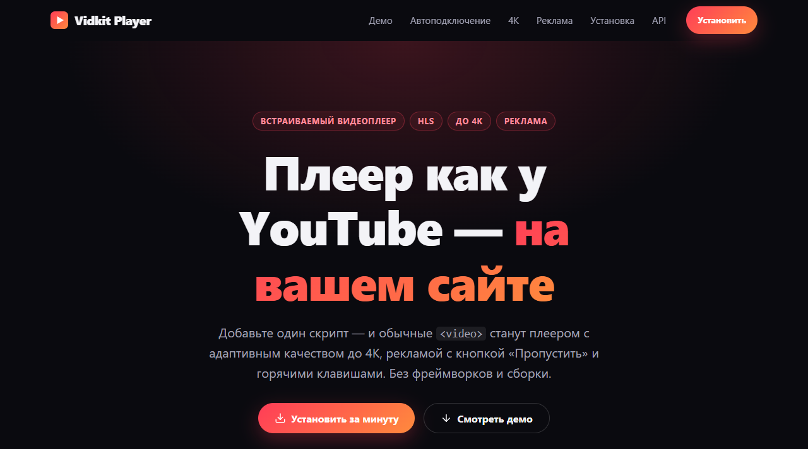
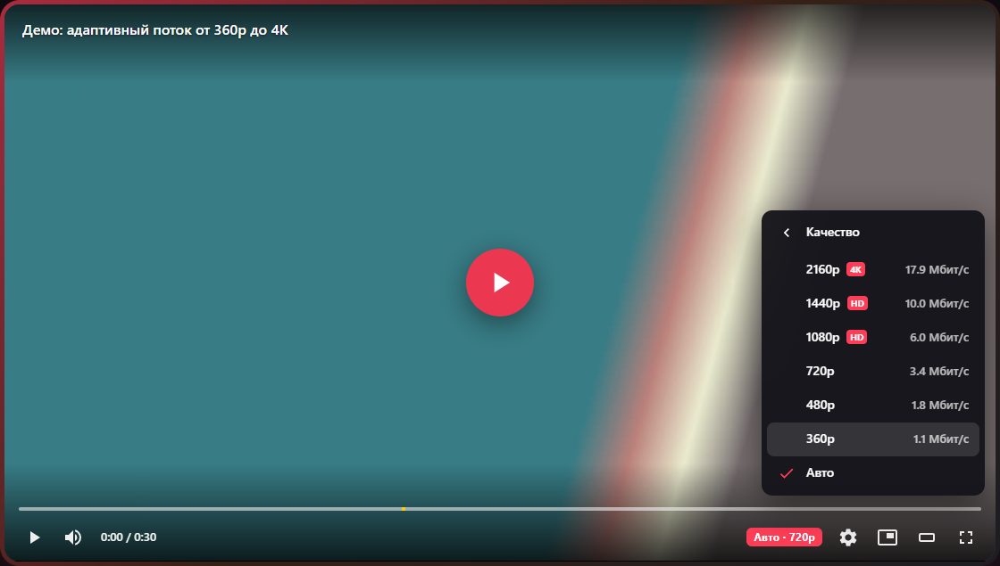
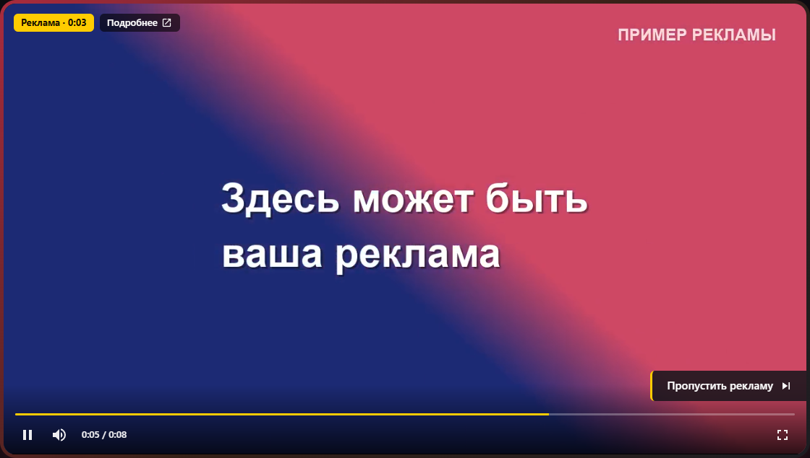
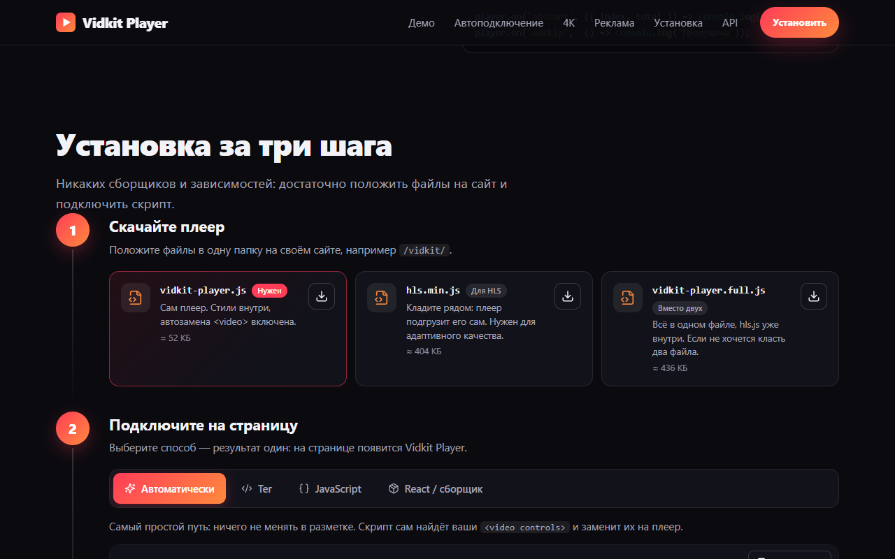
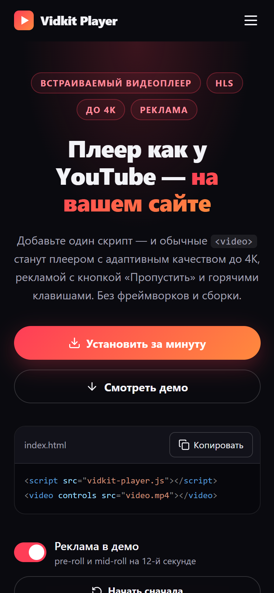

<p align="center">
  
</p>

<h1 align="center">Vidkit Player</h1>

<p align="center">
  <b>Видеоплеер в стиле YouTube для вашего сайта</b><br>
  Адаптивное качество до 4K · реклама с кнопкой «Пропустить» · автозамена обычных <code>&lt;video&gt;</code>
</p>

<p align="center">
  <a href="LICENSE"></a>
  
  
  
</p>

<p align="center">
  <a href="https://cassiel99.github.io/vidkit-player/"><b>Живое демо</b></a> ·
  <a href="#быстрый-старт">Быстрый старт</a> ·
  <a href="#возможности">Возможности</a> ·
  <a href="#подключение-на-сайт">Подключение</a> ·
  <a href="#реклама">Реклама</a> ·
  <a href="#структура-репозитория">Структура</a> ·
  <a href="#лицензия">Лицензия</a>
</p>

<p align="center">
  
</p>

---

## Что это

**Vidkit Player** — встраиваемый видеоплеер для сайтов. Добавьте на страницу один скрипт, и ваши обычные `<video controls>` превратятся в плеер с адаптивным качеством (до 4K), рекламой, горячими клавишами и удобным интерфейсом, как на YouTube. Никаких фреймворков и сборки на стороне вашего сайта.

В репозитории две независимые части:

| Часть | Что внутри |
|---|---|
| [`core/`](core) | **Ядро**: плеер и кодировщик видео. Не зависит от сайта. |
| [`site/`](site) | **Сайт-презентация** на React + Vite: демо, пошаговая установка, API. |

## Возможности

| | |
|---|---|
| **Качество до 4K** | Лесенка 2160p / 1440p / 1080p / 720p / 480p / 360p. Авто-режим не качает 4K в маленьком плеере и поднимает качество в полном экране. |
| **Реклама для сайтов** | Pre-roll, mid-roll и post-roll, блоки из нескольких роликов, кнопка «Пропустить рекламу», «Подробнее», VAST, пиксели статистики. |
| **Автоподключение** | Скрипт сам заменяет `<video controls>` на странице, в том числе добавленные позже. Фоновые видео без `controls` не трогает. |
| **Горячие клавиши** | Пробел, `J`/`L`, стрелки, цифры `0`–`9`, `F`, `M`, `T`, `I` — как на YouTube. Работают и с русской раскладкой. |
| **Кинотеатр и PiP** | Широкий режим, картинка в картинке, полный экран. Громкость и место просмотра запоминаются. |
| **Статистика** | Разрешение, кодеки, битрейт, оценка сети, буфер, пропущенные кадры — клавиша `S`. |
| **Один файл** | Стили внутри скрипта, `hls.js` подгружается сам. Подходит для обычного HTML, React, Vue. |
| **API** | Методы, события, типы TypeScript, веб-компонент `<vidkit-player>`. |

## Как это выглядит

<table>
  <tr>
    <td width="50%"></td>
    <td width="50%"></td>
  </tr>
  <tr>
    <td align="center"><sub>Выбор качества, включая 4K</sub></td>
    <td align="center"><sub>Реклама с кнопкой «Пропустить»</sub></td>
  </tr>
</table>

<table>
  <tr>
    <td width="70%"></td>
    <td width="30%"></td>
  </tr>
  <tr>
    <td align="center"><sub>Пошаговая установка</sub></td>
    <td align="center"><sub>Версия для телефона</sub></td>
  </tr>
</table>

## Быстрый старт

Нужны [Node.js](https://nodejs.org) 18+ и, только для демо-видео и кодирования, [ffmpeg](https://ffmpeg.org) (вместе с ffprobe) в `PATH`.

```bash
npm install     # зависимости ядра и сайта (npm workspaces)
npm run demo    # демо-видео и реклама для сайта (один раз, около 2 минут)
npm run dev     # собирает ядро и запускает сайт: http://localhost:5173
```

> Демо-видео (около 125 МБ) в git не хранятся: их создаёт `npm run demo`.

## Подключение на сайт

Возьмите из `core/dist/` (или со страницы «Установка» на сайте) файлы `vidkit-player.js` и `hls.min.js`, положите рядом и подключите скрипт.

**Автоматически: ничего не менять в разметке**

```html
<script src="/vidkit/vidkit-player.js"></script>

<video controls
       src="/video/movie.mp4"
       poster="/video/poster.jpg"></video>
```

**Тегом**

```html
<vidkit-player src="/video/master.m3u8" poster="/video/poster.jpg" title="Моё видео"></vidkit-player>
```

**Из JavaScript**

```js
const player = new VidkitPlayer('#mount', { src: '/video/master.m3u8' });

player.on('qualitychange', (q) => console.log(q.height));
player.setQuality(2160);   // или 'auto'
player.destroy();          // при удалении компонента
```

Все возможности (автоподключение и его исключения, React, API, события, оформление) описаны в [**core/README.md**](core/README.md).

## Реклама

```js
new VidkitPlayer('#mount', {
  src: '/video/master.m3u8',
  ads: [
    { type: 'preroll',  src: '/ads/intro.mp4', skipAfter: 5, clickUrl: 'https://example.com' },
    { type: 'midroll',  at: '50%', vast: 'https://ads.example.com/vast.xml' },
    { type: 'postroll', src: '/ads/outro.mp4', skipAfter: null },   // нельзя пропустить
  ],
});
```

- Pre-roll запускается при первом нажатии на Play, а не при загрузке страницы.
- Mid-roll отмечен жёлтой меткой на полосе перемотки.
- Если ролик не загрузился за 8 секунд, он пропускается и видео продолжается.
- Во время рекламы перемотка, скорость и качество отключены.

## Подготовка видео

Плееру нужен HLS-поток. Кодировщик из репозитория делает его из любого файла:

```bash
npm run encode -- видео.mp4 моё-видео    # результат: ./out/моё-видео/master.m3u8
```

| Качество | Видео | Звук | Для кого |
|---|---|---|---|
| 4K · 2160p | 16 Мбит/с | 192 кбит/с | Быстрый интернет, 4K-экран |
| 1440p | 9 Мбит/с | 192 кбит/с | Большой монитор |
| 1080p | 5 Мбит/с | 192 кбит/с | Обычный быстрый интернет |
| 720p | 2.8 Мбит/с | 128 кбит/с | Wi-Fi |
| 480p | 1.4 Мбит/с | 128 кбит/с | Мобильная сеть |
| 360p | 0.8 Мбит/с | 96 кбит/с | Слабый сигнал |

Качества выше разрешения исходника не создаются. Видео кодируется в H.264 + AAC.

## Структура репозитория

```text
core/                      ЯДРО — не зависит от сайта
├─ src/                    исходники плеера: player, ads, vast, auto, element, стили
├─ encoder/transcode.mjs   кодировщик: видео → HLS-лесенка до 4K
├─ types/                  типы TypeScript
└─ build.mjs               сборка → core/dist

site/                      САЙТ — использует ядро как зависимость
├─ src/                    React-компоненты и стили
├─ public/examples/        запускаемые примеры подключения
└─ scripts/                make-demo.mjs (демо-видео), sync-player.mjs (забирает core/dist)

.github/workflows/         публикация сайта на GitHub Pages
```

Связь только в одну сторону: **сайт → ядро**. Ядро ничего не знает о сайте и может жить само по себе.

## Команды

| Команда | Что делает |
|---|---|
| `npm run dev` | собирает ядро и запускает сайт (`http://localhost:5173`) |
| `npm run build` | собирает ядро (`core/dist`), затем сайт (`site/dist`) |
| `npm run build:core` | только ядро |
| `npm run preview` | показывает собранный сайт локально |
| `npm run demo` | создаёт демо-видео и рекламу в `site/public/media` |
| `npm run encode -- видео.mp4 имя` | кодирует своё видео в HLS |
| `npm run notices` | обновляет список сторонних лицензий |

## Публикация сайта на GitHub Pages

1. Загрузите репозиторий на GitHub (ветка `main`).
2. Откройте **Settings → Pages** и в поле **Source** выберите **GitHub Actions**.
3. Каждый push в `main` запускает [`deploy.yml`](.github/workflows/deploy.yml): он ставит ffmpeg, создаёт демо-видео, собирает ядро и сайт и публикует `site/dist`.

После этого сайт откроется по адресу https://cassiel99.github.io/vidkit-player/. Пути в сайте относительные, поэтому он работает и в подпапке.

> Состояние сборки и публикации видно на вкладке **Actions**.

## Совместимость и ограничения

- Проверено в **Chrome** (Windows). Остальные современные браузеры должны работать через hls.js, а Safari и iPhone — через нативный HLS (без выбора качества), но это пока не тестировалось.
- 4K в H.264 требует аппаратной поддержки на устройстве зрителя. Если её нет, плеер в авто-режиме выберет качество ниже.
- **Субтитры пока не поддерживаются.** Поэтому видео с `<track>` автоподключение не трогает.
- Пакет `vidkit-player` пока не опубликован в npm: подключайте файлы из `core/dist/`.

## Планы

- [ ] Субтитры (кнопка CC, выбор языка)
- [ ] Кодирование 4K в VP9 / AV1 для экономии трафика
- [ ] Проверка в Firefox, Safari, на iPhone и Android
- [ ] Публикация пакета в npm

## Лицензия

Проект распространяется по лицензии **MIT**: код можно свободно использовать, изменять и распространять, в том числе в коммерческих проектах, при условии сохранения текста лицензии. Полный текст: [LICENSE](LICENSE).

Плеер распространяется вместе с [hls.js](https://github.com/video-dev/hls.js) (Apache-2.0), сайт использует React, Lucide и другие библиотеки. Их лицензии перечислены в [THIRD_PARTY_NOTICES.md](THIRD_PARTY_NOTICES.md).
